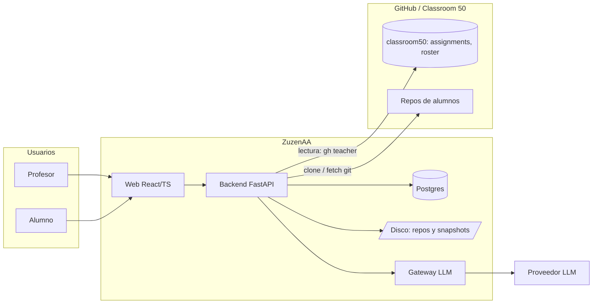
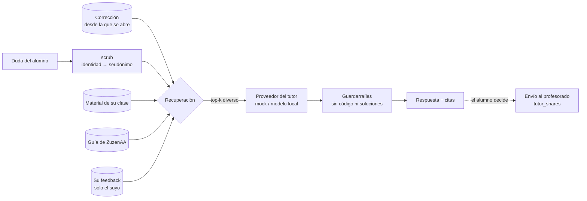
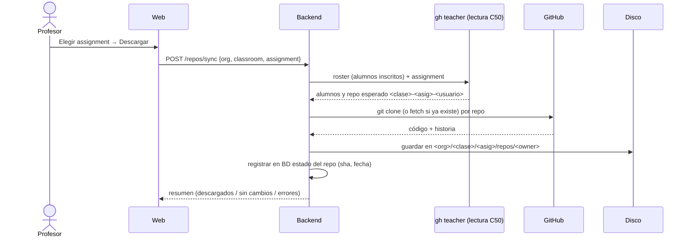
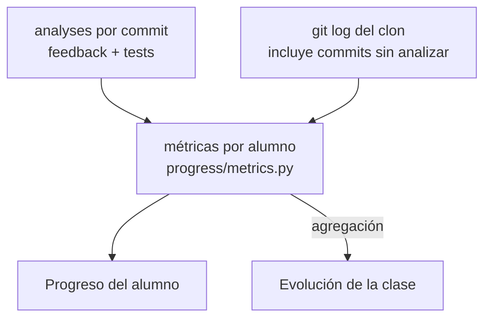
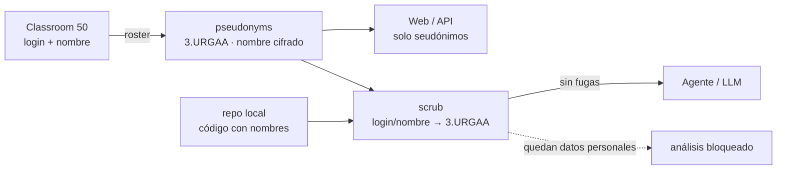

# 01 · Arquitectura

## 1. Vista general



## 2. Componentes

### 2.1 Web (React/TS)

- **Superficie profesor**: elegir org/clase/assignment; **Descargar repos**; **Analizar**; ver
  **histórico** por alumno y **progreso**.
- **Superficie alumno**: la web detecta el rol (`GET /me/role`) y el alumno entra a **Mis
  entregas** (tarjetas con tests, puntos, pista actual y avisos) → ficha en solo lectura con su
  progreso y **todo su histórico**. Sin menú de profesorado; las rutas de gestión le redirigen a
  su panel y el backend le deniega los datos.
- **Vista previa**: el profesorado pulsa «Ver como este alumno» en una ficha y ve la superficie
  del alumno (`/me/assignments?as=`), limitada a las clases donde es staff.
- Navegación: Clases → Clase → Assignment (Entregas / **Evolución de la clase**) → Ficha del
  alumno (Progreso / Histórico) y Ajustes.

### 2.2 Backend (FastAPI)

- **Auth** (GitHub OAuth): sesiones + token cifrado. Igual que el MVP.
- **Lectura de Classroom 50** (solo lectura): `gh teacher classroom/assignment/roster list`.
- **Repo Manager**: clona/actualiza repos de alumnos en disco y crea snapshots.
- **Agente** (worker): lee el código local, llama al LLM, guarda el feedback.
- **Evolución**: cada análisis se compara con el anterior (diff, feedback y tests).
- **Progreso** (`progress/`): métricas sobre el histórico completo, por alumno y agregadas por
  clase (ver §3.3).
- **Tutor RAG** (`tutor/`, R5): panel lateral (1/3 de la pantalla) que el alumno abre desde una
  **corrección** («Preguntar al tutor»). Esa corrección es la primera fuente; además recupera del
  material de **su** clase, de la guía de ZuzenAA y de **su propio** feedback, y responde con el
  proveedor del tutor (hoy `mock` local) citando cada fragmento. El alumno puede **enviar la duda
  y la conversación a su profesorado**, ligada a esa corrección; el profesor la lee en la ficha y
  la marca como leída. Mismos guardarraíles que el agente (orienta, no resuelve) y misma
  privacidad (seudónimo, limpieza y bloqueo). Todo en el servidor: nada sale a internet.


- **Persistencia**: BD (metadatos/estado) + disco (código).

### 2.3 Almacenamiento

- **Disco del servidor** (volumen Docker), estructura por org/clase/assignment/alumno.
- Migrable a MinIO/S3 detrás de una interfaz de almacenamiento.

## 3. Flujos

### 3.1 Descargar repos de un assignment



### 3.2 Analizar con el agente

El análisis se lanza en dos momentos y siempre sobre el **último push** del alumno
(`agent/service.py: sync_and_analyze`):

- Al pulsar **Analizar** / **Analizar todos**: primero descarga, luego analiza.
- Al hacer **push**: hoy solo en el modo demo («Simular push», `docs/06-datos-de-prueba.md`).
  Con GitHub real (webhook o sondeo) está pendiente.

Si el commit ya estaba analizado devuelve el análisis guardado (`cached`); **Reanalizar** fuerza
uno nuevo. Si la descarga falla, el alumno sale como `error` y no se analiza código viejo.

```mermaid
sequenceDiagram
    actor P as Profesor
    participant W as Web
    participant B as Backend
    participant FS as Disco
    participant GW as Gateway LLM
    participant DB as BD
    P->>W: Analizar (alumno o todos)
    W->>B: POST /analysis {scope}
    B->>FS: descargar el último push (git fetch + reset)
    B->>FS: leer repo local + diff/snapshot
    B->>DB: ¿hay análisis de este commit? (cache; forzar opcional)
    alt no cacheado o forzar
        B->>GW: contexto + código (diff, evidencias)
        GW-->>B: feedback estructurado (guardarraíles)
        B->>FS: snapshot congelado del commit
        B->>DB: guardar análisis (commit, fecha, feedback, evolución)
    end
    B-->>W: resultado
```

### 3.3 Ver histórico y progreso

- **Histórico**: lista de análisis por alumno/repo, ordenada por fecha, con commit, feedback y tests.
- **Progreso del alumno** (ficha → «Progreso»; alumno y profesorado):
  `GET .../assignments/{a}/repos/{owner}/progress`. Curva de puntos de tests por revisión, cuándo
  empezó a pasar cada test y si se rompió después (regresiones), pista que se repite, ritmo de
  trabajo (commits, días con actividad, tamaño) y avisos. Incluye un resumen formativo.
- **Evolución de la clase** (assignment → «Evolución de la clase»; **solo profesorado**):
  `GET .../assignments/{a}/progress`. Media diaria de puntos, tasa de aprobado por test (el que más
  cuesta primero), pistas comunes y alumnos con avisos.



- **Una sola fuente de verdad**: la evolución de la clase agrega el progreso de cada alumno; nunca
  se calcula aparte, así ambos cuentan lo mismo.
- **Se calcula al leer** (no hay tabla nueva): son operaciones baratas sobre la BD y el `git log`,
  y así siempre está al día tras un push o un «Analizar».
- **Resúmenes deterministas** (plantillas, como el proveedor `mock`): orientan sin dar la solución.
  Si un LLM real los redacta, se cachearán por el último análisis incluido.
- **Avisos**: `sin_analisis`, `regresion` (la última revisión rompe tests que pasaban),
  `pista_repetida` (misma pista en ≥ 3 revisiones seguidas y aún quedan tests),
  `sin_avance` (≥ 7 días sin commits con tests pendientes).

## 4. Seguridad y coste

### 4.1 Privacidad del alumnado



- **Seudónimo por clase** `<posición>.<AP1><AP2><N>`, fijado la primera vez y estable.
- **La identidad nunca sale hacia el LLM**: limpieza del contexto + verificación final.
- **Web**: solo seudónimos (también en URLs, nombres de repo y mensajes de error de git). El
  alumno no ve su login ni en la cabecera.
- **«Mostrar identidad»**: solo staff, bajo demanda, registrado (`identity_reveals`); no se guarda
  en la caché de la web.
- Límite: unas iniciales con posición son un **seudónimo**, no un anonimato total; quien conozca la
  lista de clase puede deducir la identidad.

### 4.2 Resto

- El token del profesor se **cifra en reposo**; cada petición usa su identidad.
- El **LLM** se llama desde el **gateway del backend**; la clave vive en el servidor, nunca en repos
  de alumnos.
- Análisis **bajo demanda**, **cache por commit** (con forzar reanálisis) y límite de diff para
  controlar el gasto.
- El agente corre como **worker del backend** (0 minutos de GitHub Actions).

## 5. Riesgos

| ID | Riesgo | Mitigación |
| --- | --- | --- |
| R1 | Volumen de disco por repos + snapshots | Retención, snapshots comprimidos, migración a objetos. |
| R2 | Clones lentos/grandes (N alumnos × historia) | Clon superficial/filtrado, colas y progreso. |
| R3 | Coste LLM por análisis | Bajo demanda, cache por commit, presupuesto, límite de diff. |
| R4 | Privacidad: código del alumno a LLM externo | Proveedor UE o local; consentimiento; minimización. |
| R5 | Repo aún no aceptado / renombrado | Ignorar y reportar; reintentar tras aceptación. |
| R6 | Histórico atado a la BD | Exportar `analyses.json`/`feedback.md` junto al código. |
| R7 | Cambios en el CLI de Classroom 50 | Fijar versión; adaptador aislado; tests de contrato. |
