<!-- _class: portada -->
<!-- _paginate: false -->
<!-- _footer: '' -->

# ZuzenAA

Feedback formativo en cada push, sin dar nunca la solución.

<p class="nota">Proyecto del curso IKKP · Agentes de IA · octubre de 2026</p>

---

### El problema

## Los tests dicen qué falla. No enseñan por qué.

- Un alumno de programación sube su código **muchas veces** antes de entregar.
- Classroom 50 ejecuta los tests en cada push, pero el resultado es un sí o un no.
- El profesorado no puede revisar cada commit ni ver a tiempo **quién se ha atascado**.
- Las herramientas de IA generalistas **dan la solución** y no protegen la identidad del alumnado.

---

### Qué es

## ZuzenAA corrige cada entrega y guía sin resolver

| Hace | No hace |
|---|---|
| Descarga cada push y guarda el histórico por commit | Gestionar clases, tareas o tests: eso sigue en Classroom 50 |
| Analiza el código con un agente que da feedback estructurado | Volver a ejecutar los tests: los lee de GitHub Actions |
| Calcula el progreso de cada alumno y de la clase | Publicar nada en GitHub: el feedback vive en la plataforma |
| Ofrece un tutor que responde con los apuntes de la clase | Escribir código o dar la respuesta |
| Identifica al alumnado con un seudónimo (`6.URGAA`) | Enviar nombres o logins a un modelo de IA |

---

### Cómo funciona

## Cada push se convierte en feedback en cinco pasos

1. El alumno hace push y Classroom 50 ejecuta los **tests** en GitHub Actions.
2. ZuzenAA **descarga** ese commit y lee el resultado de los tests.
3. El **agente de feedback** analiza el código, compara con la revisión anterior y escribe funcionalidad, calidad, diseño y una **pista**.
4. El **progreso** y los **avisos** se recalculan: regresión, sin avance o pista repetida.
5. Si el alumno tiene dudas, abre el **tutor** desde esa corrección. Si sigue atascado, la envía al profesorado.

---

### Arquitectura

## Una arquitectura sencilla, sobre lo que el centro ya usa

| Capa | Tecnología | Función |
|---|---|---|
| Web | React, TypeScript, Vite | Muestra la vista de profesorado o de alumnado según el rol |
| API | FastAPI (Python 3.12) | Autenticación con GitHub, permisos y seudónimos |
| Datos | PostgreSQL y disco del servidor | Histórico, seudónimos y apuntes; clones del código en disco |
| Classroom 50 | CLI `gh teacher`, solo lectura | Clases, alumnado, profesorado y tareas |
| Agentes | Feedback y tutor | Interfaz de proveedor, guardarraíles y salida validada |
| Modelo | Anthropic o API compatible con OpenAI | Se elige en `.env`; sin clave, modo básico |
| Despliegue | Docker Compose | `make up` levanta base de datos, API y web |

---

### Agentes

## Dos agentes, una misma regla: orientar, no resolver

| | Agente de feedback | Agente tutor |
|---|---|---|
| Cuándo actúa | En cada push y al pulsar «Analizar» | Cuando el alumno pregunta desde una corrección |
| Qué recibe | Código, diferencias, tests y feedback anterior | Duda, corrección, apuntes de la clase y su propio feedback |
| Herramientas | Ninguna | `buscar_apuntes` y `responder` |
| Qué devuelve | Funcionalidad, calidad, diseño y pista | Explicación, preguntas guía, pasos y apuntes a revisar |

Los apuntes se indexan en la propia base de datos. El tutor solo busca en los de **esa clase** y en el feedback **de ese alumno**.

---

### Privacidad

## La identidad del alumnado no sale del servidor

- Cada alumno tiene un **seudónimo de clase**: número de lista e iniciales. `6.URGAA` es la n.º 6, **Ur**rutia **Ga**rmendia, **A**ne.
- La web y la API solo usan seudónimos. El nombre real se guarda cifrado.
- Antes de **cada** llamada a un modelo se sustituyen login, nombre y apellidos, y se comprueba que no queda ninguno. Si quedara, la llamada no se hace.
- El profesorado puede ver la identidad de un alumno concreto; cada consulta queda registrada.

<div class="cifras">
<div><b>0</b><span>fugas en 47 respuestas de la API auditadas</span></div>
<div><b>1</b><span>único punto que devuelve la identidad real</span></div>
</div>

---

### Calidad

## Cada respuesta pasa controles antes de llegar al alumno

- Si una respuesta contiene código o «la solución es…», el agente debe reescribirla. Si insiste, se bloquea.
- Nunca se muestra texto libre del modelo: solo campos validados, y las citas solo pueden apuntar a apuntes recuperados.
- Sin clave, o si el proveedor falla, responde el modo básico con la misma estructura.
- Un límite de preguntas por alumno y hora acota el gasto.

<div class="cifras">
<div><b>83</b><span>tests automáticos, sin red</span></div>
<div><b>30</b><span>casos para evaluar el tutor</span></div>
<div><b>0,0005 $</b><span>por respuesta con el modelo más barato</span></div>
</div>

---

<!-- _class: seccion -->
<!-- _paginate: false -->
<!-- _footer: '' -->

### Caso práctico 1 · Profesorado

# Detectar quién necesita ayuda y responder a tiempo

---

### Profesorado · recorrido completo

## Del aula a la duda de una alumna, en 33 segundos

<video controls preload="metadata" poster="img/profesor-03-entregas.png" src="video/recorrido-profesor.webm"></video>

<p class="nota">Si el vídeo no se reproduce aquí, ábrelo en <code>video/recorrido-profesor.webm</code>.</p>

---

<div class="split">
<div>

### Paso 1

## La clase y sus apuntes, en un solo lugar

- Entra con GitHub y elige la clase; los datos vienen de Classroom 50.
- Sube sus apuntes en `.md` o `.txt`. El tutor los usará y los citará.

</div>
<div>

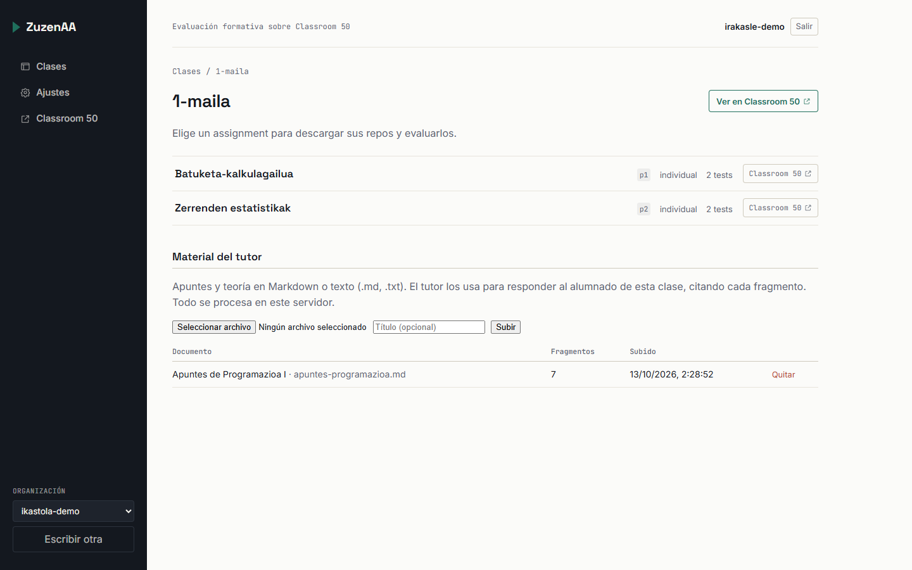

</div>
</div>

---

<div class="split">
<div>

### Paso 2

## Cada alumno aparece con un código, no con su nombre

- «Descargar repos» trae el último push de todos.
- «1 duda(s)» avisa de una pregunta pendiente.
- Una entrega no aceptada aparece como `error`.

</div>
<div>

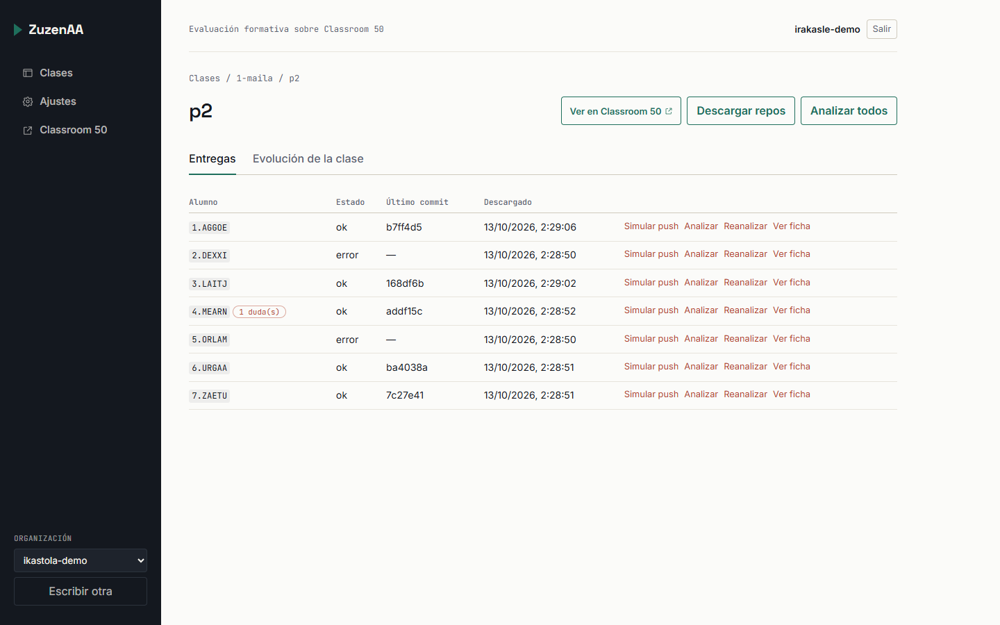

</div>
</div>

---

<div class="split">
<div>

### Paso 3

## Un push se descarga, se prueba y se analiza solo

- Nadie tiene que pulsar nada: el feedback está listo al subir el código.
- En la demo, «Simular push» reproduce el ciclo: `tests 2/2 · analysed`.

</div>
<div>

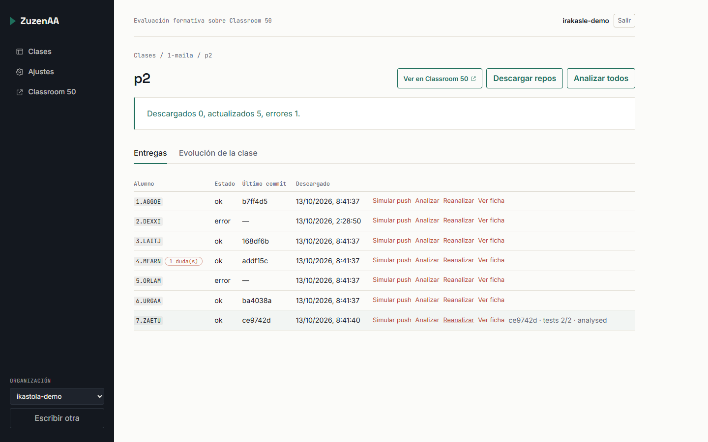

</div>
</div>

---

<div class="split">
<div>

### Paso 4

## La evolución de la clase señala dónde intervenir

- `test_mediana` solo lo pasa el 40 %: merece una explicación en clase.
- Las pistas repetidas revelan dudas comunes.
- Los avisos señalan a quien lleva días sin avanzar.

</div>
<div>

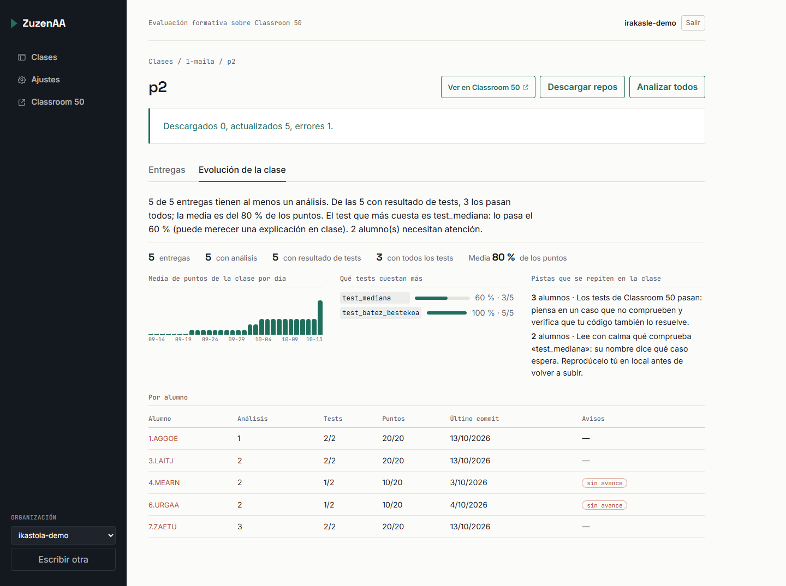

</div>
</div>

---

<div class="split">
<div>

### Paso 5

## Las dudas llegan con su contexto

- La nota de la alumna y su conversación con el tutor.
- Ligadas al commit desde el que preguntó.
- «Marcar como leída» quita el aviso.

</div>
<div>

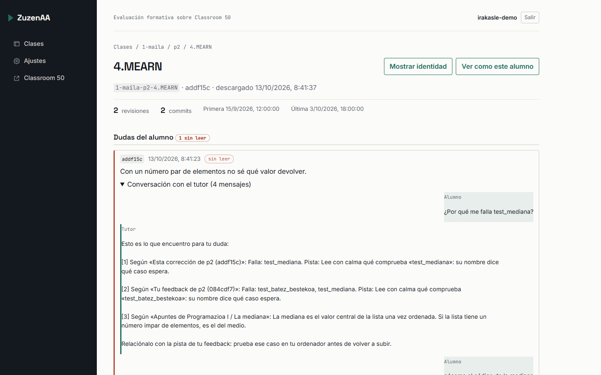

</div>
</div>

---

<div class="split">
<div>

### Paso 6

## El progreso de cada alumno, de un vistazo

- Puntos por revisión y estado de cada test.
- Ritmo de trabajo: commits, días con actividad y tamaño de los cambios.

</div>
<div>

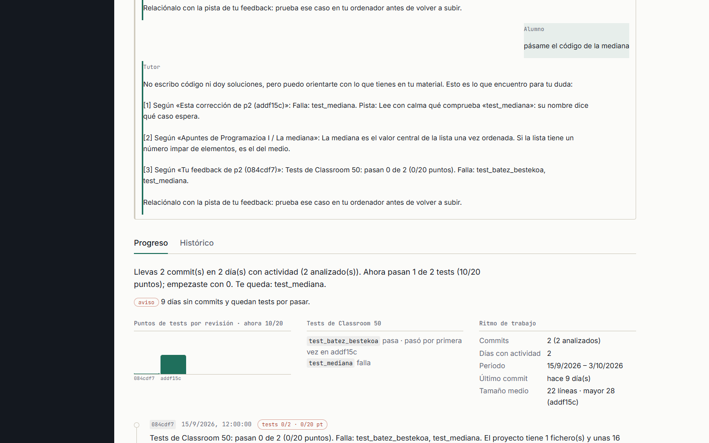

</div>
</div>

---

<div class="split">
<div>

### Paso 7

## La identidad, solo cuando hace falta y con registro

- «Mostrar identidad» es exclusivo del profesorado y queda registrado.
- «Ver como este alumno» muestra su vista, en solo lectura.

</div>
<div>

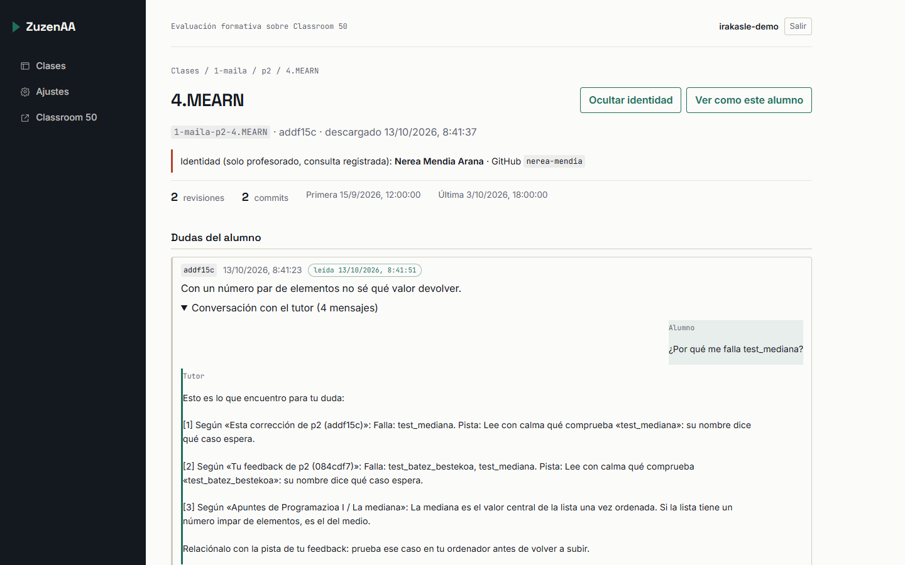

</div>
</div>

---

<!-- _class: seccion -->
<!-- _paginate: false -->
<!-- _footer: '' -->

### Caso práctico 2 · Alumnado

# Entender el fallo y aprender a resolverlo

---

### Alumnado · recorrido completo

## De la tarjeta de la tarea a la duda enviada

<video controls preload="metadata" poster="img/alumno-04-tutor.png" src="video/recorrido-alumno.webm"></video>

<p class="nota">Si el vídeo no se reproduce aquí, ábrelo en <code>video/recorrido-alumno.webm</code>.</p>

---

<div class="split">
<div>

### Paso 1

## El alumno ve primero lo que tiene que hacer

- Una tarjeta por tarea: tests, puntos, su pista actual y avisos.
- Nada de la vista del profesorado.
- Su código de clase, `4.MEARN`, en lugar de su nombre.

</div>
<div>

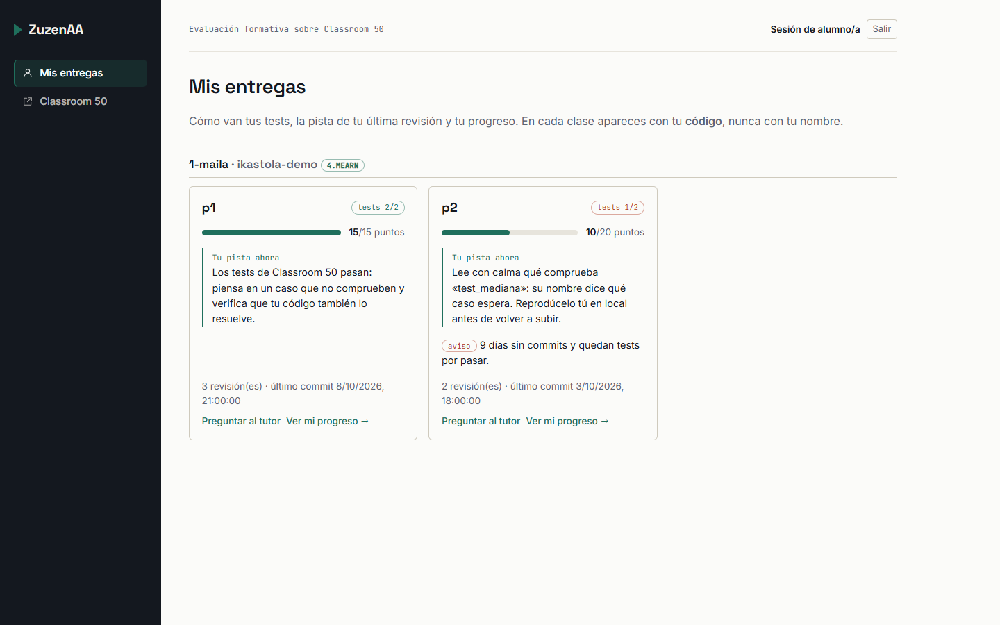

</div>
</div>

---

<div class="split">
<div>

### Paso 2

## Su progreso, explicado en lenguaje claro

- «Ahora pasan 1 de 2 tests. Te queda: `test_mediana`».
- Cada corrección tiene su botón «Preguntar al tutor».

</div>
<div>

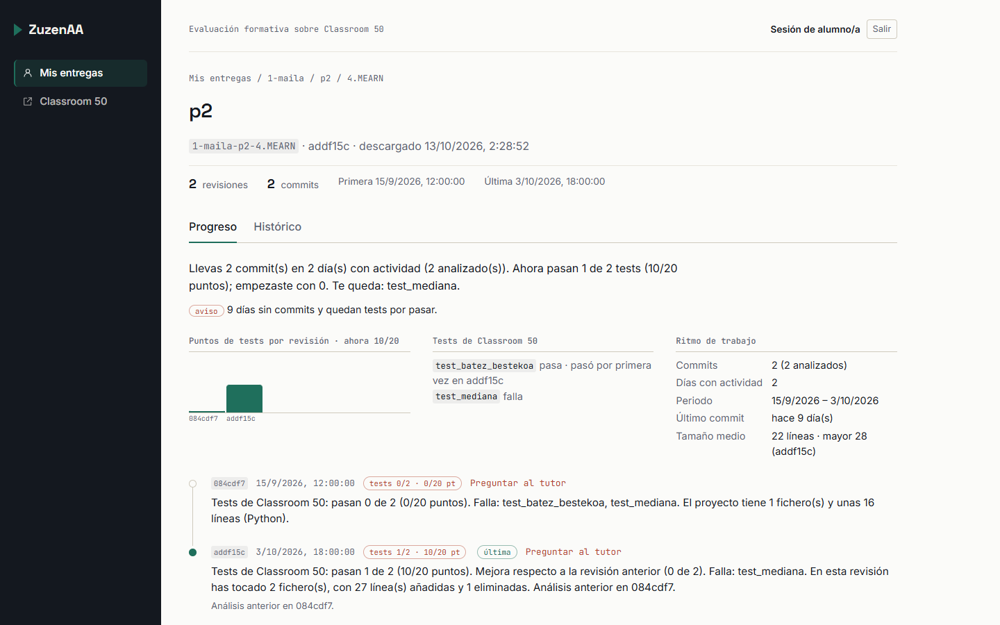

</div>
</div>

---

<div class="split">
<div>

### Paso 3

## Todo el feedback, commit a commit

- Funcionalidad, calidad, diseño y pista de cada revisión.
- Qué tests pasan y cuáles fallan en cada una.

</div>
<div>

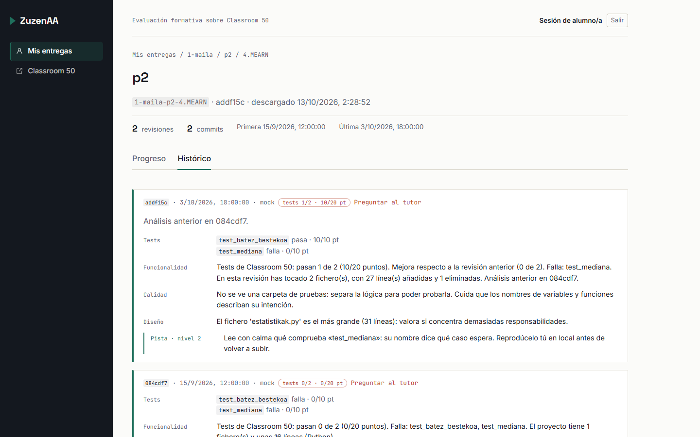

</div>
</div>

---

<div class="split">
<div>

### Paso 4

## El tutor parte de la corrección y cita los apuntes

- Ocupa un tercio de la pantalla, junto a su trabajo.
- Responde con una explicación, preguntas para pensar, pasos y los apuntes que debe repasar.

</div>
<div>

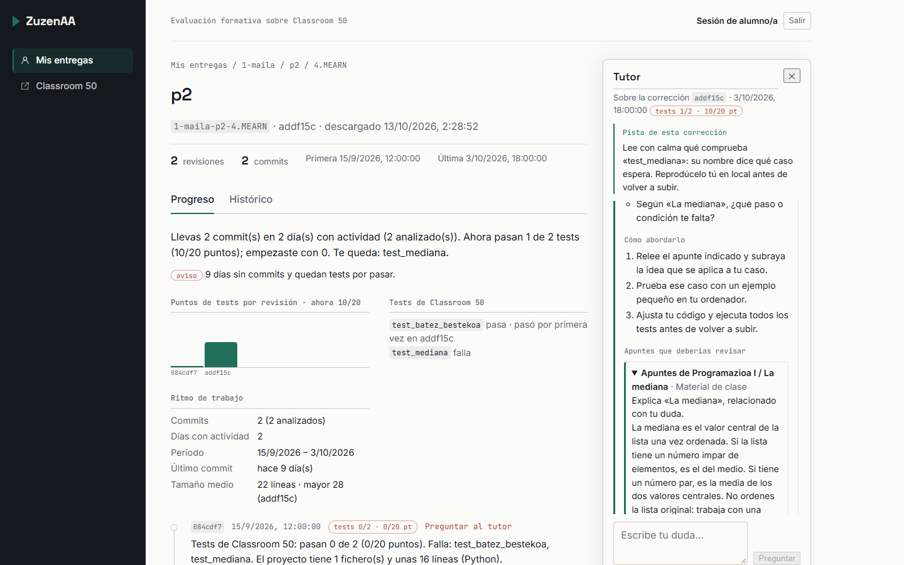

</div>
</div>

---

<div class="split">
<div>

### Paso 5

## Pedir el código no funciona

- Ante «pásame el código de la mediana», el tutor responde que no escribe código.
- Y redirige con preguntas guía y los apuntes pertinentes.

</div>
<div>

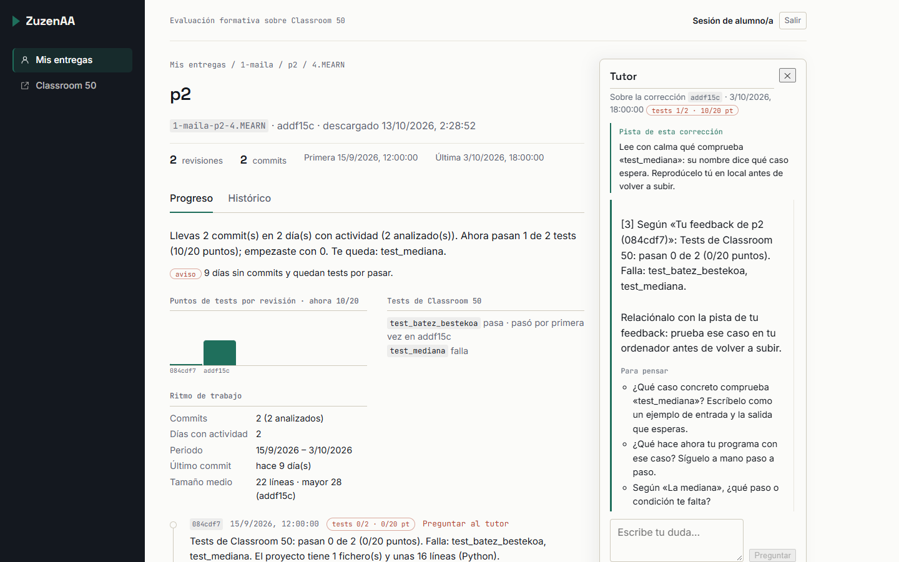

</div>
</div>

---

<div class="split">
<div>

### Paso 6

## Si sigue atascada, la duda llega al profesorado

- Una nota y, si quiere, la conversación con el tutor.
- Viaja con su código de clase, nunca con su nombre.
- Después ve si está leída.

</div>
<div>

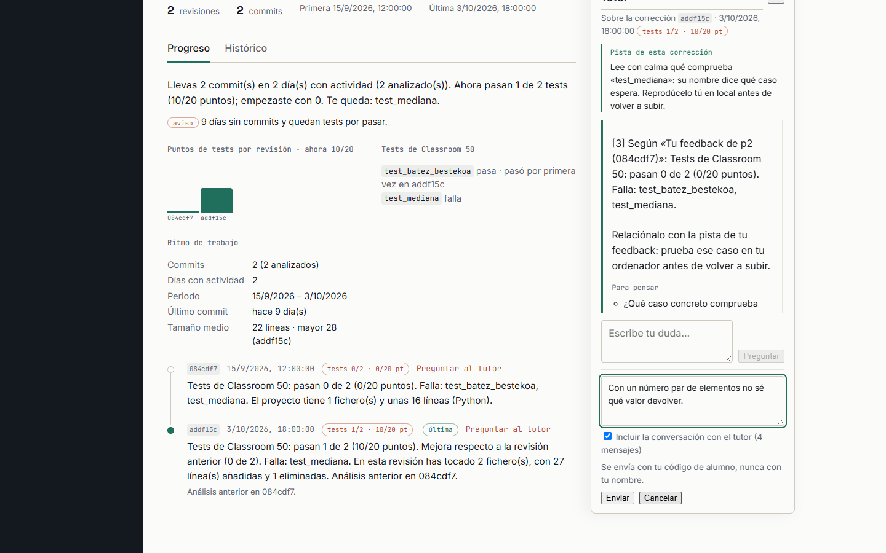

</div>
</div>

---

### Estado

## Lo que funciona hoy y lo que falta

| Funciona | Falta |
|---|---|
| Classroom 50 simulado para la demo | Elegir el modelo del tutor con la evaluación de 30 casos |
| Análisis en cada push y bajo demanda | Registrar tokens y coste por respuesta |
| Progreso del alumno y evolución de la clase | Que el profesorado responda dentro de la plataforma |
| Seudónimos y privacidad frente a los modelos | Un modelo real para el agente de feedback |
| Tutor con agente y envío de dudas | Búsqueda vectorial si los apuntes crecen |

<p class="nota">Las capturas muestran el tutor en modo básico: misma estructura, con respuestas de plantilla. Con la clave del proveedor, esas secciones las redacta el modelo.</p>

---

### Probarlo

## Arrancar la demo lleva tres comandos

```sh
cp .env.example .env        # y pon ZUZENAA_DEMO_MODE=true
make up                     # base de datos, API y web
docker compose exec backend python -m zuzenaa.demo.seed
```

- La web queda en `http://localhost:8080`.
- Configuración y tutor: `docs/05-guia-configuracion.md`. Demo: `docs/06-datos-de-prueba.md`.
- Tests: `cd backend && uv run pytest`.
- **Deja espacio en disco.** Cada reconstrucción acumula caché de Docker (más de 15 GB en este proyecto). Si el disco se llena, `docker builder prune` la borra sin tocar imágenes ni datos. Docker Desktop no devuelve ese espacio a Windows hasta que se compacta su disco virtual.
